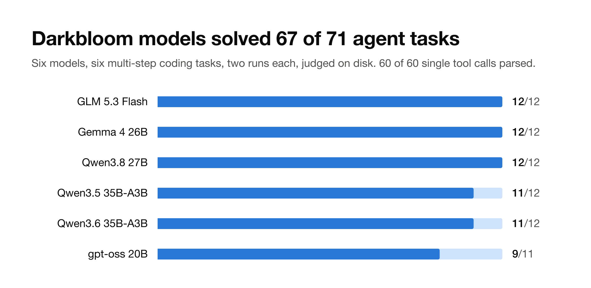
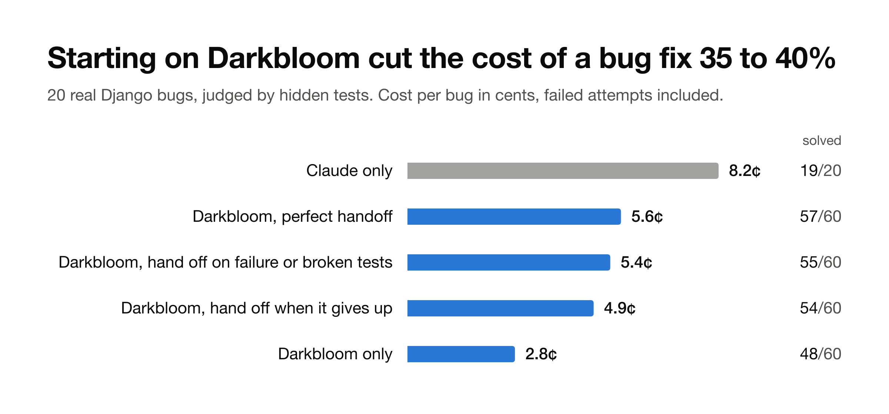

# bloomcall

Experiments on one question: can the work coding agents do run on Darkbloom, the network of idle Macs?

| # | Experiment | Status |
|---|---|---|
| 1 | Can Darkbloom's models run an agent loop? | Done, below |
| 2 | Does starting a coding agent on Darkbloom and handing off to Claude save money? | Done, below |

## Experiment 1: Darkbloom's models can run an agent loop



Across six Darkbloom models, 60 of 60 tool calls parsed cleanly and 67 of 71 multi-step agent episodes were solved, for about seven cents in total.

This started as an attempt to run a 27B coding model on a 16 GB Mac. At 2-bit it ran at 0.4 tokens per second, about 200 seconds per tool call. The same Qwen3.8-27B base model on Darkbloom answered the same two requests in 2.1 and 2.3 seconds, so the question became whether Darkbloom's models can be the brain of an agent.

| Model | Single-turn tool calls | Multi-turn episodes solved |
|---|---|---|
| Qwen3.8-27B (4-bit, MTP) | 10/10 | 12/12 |
| gemma-4-26b | 10/10 | 12/12 |
| glm-5.3-flash | 10/10 | 12/12 |
| qwen3.5-35b-a3b | 10/10 | 11/12 |
| qwen3.6-35b-a3b | 10/10 | 11/12 |
| gpt-oss-20b | 10/10 | 9/11 |

What was tested:

- **Single-turn.** Ten requests that each need one of six agent tools (read, write, edit, shell, grep, glob). A pass is a structured tool call naming an offered tool with its required arguments.
- **Multi-turn.** Six small coding tasks, each run twice: fix a bug without touching the tests, read a value from a config, count rows in a CSV, rename a function across three files, find a planted AWS key next to a decoy, and fix a SQL injection. Every tool call runs for real and its result goes back to the model. A judge checks the files on disk afterwards. File tools are confined to the task folder. Shell runs under macOS sandbox-exec with network access denied and writes limited to the system temporary directory that holds the task folder.

Across 308 tool-using turns, no model called a tool that did not exist or left out a required argument. Single-turn requests took 1.4 to 5.8 seconds end to end.

### Two issues for Darkbloom

1. **gpt-oss-20b returns tool calls as raw Harmony text.** On the rename task, gpt-oss-20b's next tool call came back in `content` as `to=functions.read?commentary<|constrain|>json<|message|>{...}`, with `tool_calls` empty, so an agent has nothing to run. Replaying the same conversation reproduced it 7 times out of 7. Reproduce with `python3 -I repro/replay.py harmony_leak`.
2. **An intermittent HTTP 422 on gpt-oss-20b.** One conversation returned `422 {"code":"model_capability","message":"inference generation failed"}` on the original run and on 3 of 3 replays shortly after, then succeeded on 2 of 2 replays later. Replay with `python3 -I repro/replay.py http_422`.

The other two failed episodes were model behaviour, not platform issues: qwen3.5-35b-a3b renamed the function in two of three files and reported it done, and qwen3.6-35b-a3b found the real key, then stopped with an empty reply without writing its findings.

### Limits

The tasks are small and each ran twice, so this shows the agent loop works on Darkbloom, not which model is best. Timings include the network path from one location.

## Experiment 2: starting on Darkbloom cuts the cost of a bug fix by 35 to 40%



A coding agent that starts every bug on a Darkbloom model and hands it to Claude when that fails solved 54 to 55 of 60 real bugs, at 60 to 65% of the cost of Claude alone. That cost includes every failed Darkbloom attempt and every Claude run after a handoff.

The setup:

- 20 Django bugs from SWE-bench Verified, picked by a fixed random seed. Each is judged by the hidden tests its real fix had to pass.
- Claude Code works each bug once on Claude Opus 5.5, and three times on nvidia-nemotron-3.5-super served by Darkbloom through a small bridge that translates Anthropic API calls to OpenAI ones. Both get the same prompt, tools, 60-turn limit, and sandbox with no network.
- Nemotron was picked from four Darkbloom models on four trial bugs kept out of the main set.
- A handoff rule decides when a Darkbloom attempt goes to Claude. A handed-off bug costs the Darkbloom attempt plus Claude's run on it.

| Policy | Solved | Cost per bug | Cost vs Claude alone (95% CI) |
|---|---|---|---|
| Claude only | 19/20 | 8.2¢ | 1.00 |
| Darkbloom, hand off when it gives up | 54/60 | 4.9¢ | 0.60 [0.30, 0.85] |
| Darkbloom, hand off on failure or broken tests | 55/60 | 5.4¢ | 0.65 [0.30, 0.95] |
| Darkbloom, perfect handoff | 57/60 | 5.6¢ | 0.69 [0.36, 0.95] |
| Darkbloom only | 48/60 | 2.8¢ | 0.35 [0.26, 0.42] |

Giving up means the agent ended with an error or changed no source file. Broken tests means Django's existing tests stop passing after the change. Perfect handoff hands off exactly when the hidden tests fail, which no real system can see, so it marks the best any rule could do. Intervals come from resampling the 20 bugs.

Darkbloom costs are what Darkbloom billed: the account balance fell by $2.06 over the run, and the calls priced from returned usage add up to $2.04. Claude costs are Claude Code's own reported cost, and a relay that saw every Claude request priced them to the same $1.64.

What the run shows:

- **The saving holds.** Both practical rules stay below Claude's cost at the top of their intervals, and give up 3 to 5 points of solve rate for it.
- **Failed calls cost nothing.** The bill matches the successful calls to within 2 cents, so the 167 calls that ended in a rate limit or a timeout were not charged. A stuck attempt costs only the tokens it actually got back.
- **Some wrong fixes get through.** The give-up rule accepted 6 fixes that looked finished and failed the hidden tests, and checking Django's existing tests caught one of them. On django-14315 nemotron wrote the same partial fix three times, passing 7 of 11 hidden tests, and Claude failed that bug too.
- **Darkbloom attempts take longer.** The median Darkbloom attempt took 247 seconds against 30 for Claude. Attempts are capped at 30 minutes, and a capped attempt counts as a failure.
- **Three bugs were out of reach.** Nemotron failed all three attempts on django-14792, 14315 and 15252.

### Limits

Twenty bugs from one repository give wide intervals, and only one Darkbloom model ran the main set. Claude ran each bug once, so its 19/20 is the least certain number in the table. One Darkbloom attempt, django-15554 rep 1, ran 2,258 seconds and was solved before the 30-minute cap existed. Under the cap, Darkbloom alone solves 47/60 and the perfect handoff costs 0.72 of Claude, while the two practical rules do not change. Two attempts on django-14017 have inflated times because the Mac slept mid-run.

## Reproduce

### Experiment 1

Python 3 and a Darkbloom API key in a file named by `HEARTH_API_KEY_FILE`.

```
python3 -I bench/test_mt.py
HEARTH_API_KEY_FILE=~/.config/hearth/darkbloom.key python3 -I bench/at0.py results/single-turn/MODEL https://api.darkbloom.dev/v1 0 MODEL
HEARTH_API_KEY_FILE=~/.config/hearth/darkbloom.key python3 -I bench/mt.py results/multi-turn/MODEL https://api.darkbloom.dev/v1 MODEL 2
python3 -I bench/rescore.py results/multi-turn
HEARTH_API_KEY_FILE=~/.config/hearth/darkbloom.key python3 -I repro/replay.py harmony_leak
```

Every request, response and transcript is in `results/`. Multi-turn scores come from `summary.rescored.json`, which reapplies the final tool-call leak detector to the saved transcripts.

### Experiment 2

Every attempt is in `results/experiment-2/`: `results.jsonl` holds each pilot and main attempt as recorded, `results.billed.jsonl` replaces the main Darkbloom costs with billed usage, and `report.billed.json` holds the numbers above. Each attempt also has its Darkbloom call ledger in `ledgers/` and its code change in `diffs/`. The harness that ran the experiment (bridge, sandbox, judge and runner) is not in this repo yet.

```
python3 -I chart/make_chart_exp2.py results/experiment-2/report.billed.json chart/experiment-2.svg
```

## Links

- Darkbloom: https://darkbloom.dev
- Darkbloom on GitHub: https://github.com/Layr-Labs/d-inference
- SWE-bench Verified: https://www.swebench.com
